<div align="center">

<picture>
  <source media="(prefers-color-scheme: dark)" srcset="assets/header-dark.png">
  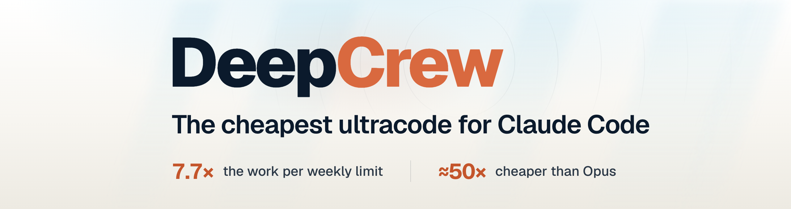
</picture>

<a href="https://youtu.be/1oBeAtoFsFU">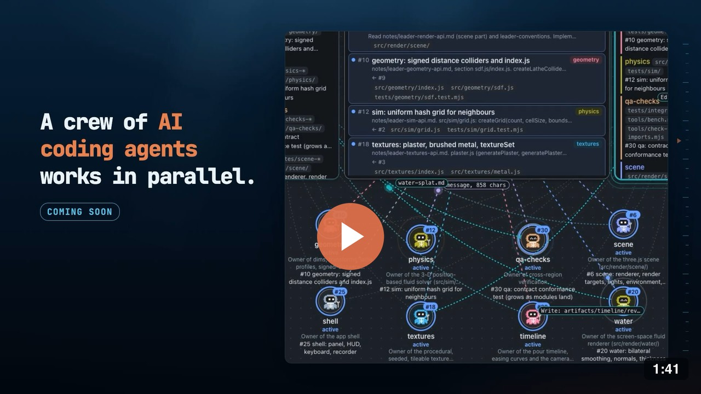</a>

**一队跑在 DeepSeek 上的普通 Claude Code agent，由你自己的 Claude Code 或 Codex 带队，配置和审批都在聊天旁边的一个页面里完成。**

[](#requirements)
[](#requirements)
[](LICENSE)

[English](README.md) | **中文**

[Why](#why-i-built-deepcrew) | [Team page](#the-team-page) | [Demo](#demo) | [Big jobs](#built-for-big-jobs) | [Quick start](#quick-start) | [Mod](#claude-code-mod) | [How it works](#how-the-swarm-works) | [Cost](#what-it-costs) | [Settings](#settings) | [Prompts](#a-call-for-prompts)

</div>

## Why I built DeepCrew

ultracode 好用，但是真贵，跑几个大活一周的额度就见底了。更难受的是在所有 agent 跑完之前，我基本看不到它们在干什么，方向不对也插不上手，等结果出来才发现根本不是我要的。Codex 的多 agent 模式也是一样。

所以我想要这样一个 swarm：干活的 agent 跑在便宜的模型上，我能随时看到每个 agent 在做什么，它们要跑的命令和要问的问题都在一个地方处理，默认配置拿来就能用，项目有特殊要求时也能调。DeepCrew 就是照着这个思路做的，现在它已经是我每天写代码的一部分，所以我会一直用，也会一直更新。

<p align="center">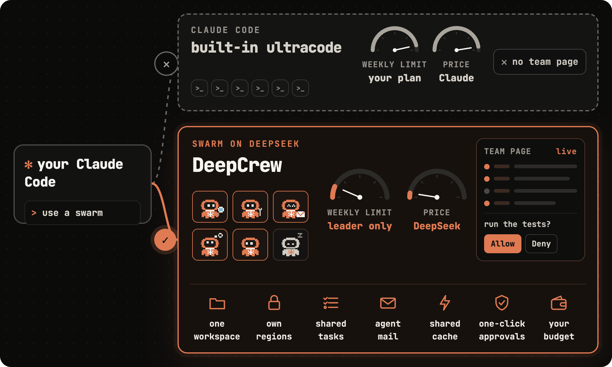</p>

- 每个 agent 都是普通的 `claude` 进程，用的是 Claude Code 自己的全套工具，也会读你项目里的 `CLAUDE.md`。带队的 leader 可以是你自己的 Claude Code，也可以是 Codex。
- 只有 leader 用你的 Claude 套餐，干活的 agent 都跑在 DeepSeek 上，我实测同一份周额度能干的活大约是全用 Claude 时的 7.7 倍，算法写在下面的 [What it costs](#what-it-costs)。
- 默认用 DeepSeek，Z.ai、智谱 GLM 和 MiniMax 也都配好了，别的兼容 Anthropic 接口的服务商加几行配置就能用，正在用的那家没余额或者一直过载时，会自动切到你设的备用服务商。
- key、preset、审批、agent 的提问和预算都在聊天旁边的团队页面上处理。Claude Code 2.1.287 及以上装了 mod 以后，agent 的请求会直接出现在输入框上方，按一下就能批。
- 每个 agent 大约占 300 MB 内存，16 GB 的机器能同时跑 20 个左右。

## The team page

团队页面开在聊天旁边，平时管这支 swarm 不用敲命令，在页面上点就行。

<table>
<tr>
<td width="50%" valign="top"><b>Team Call</b><br>谁在说话，谁就站到台前，旁边是它共享的屏幕：它的任务、它占着的文件，或者它最后截的图。agent 有事要问时会举手，你在通话旁边那一栏里回答。<br><br>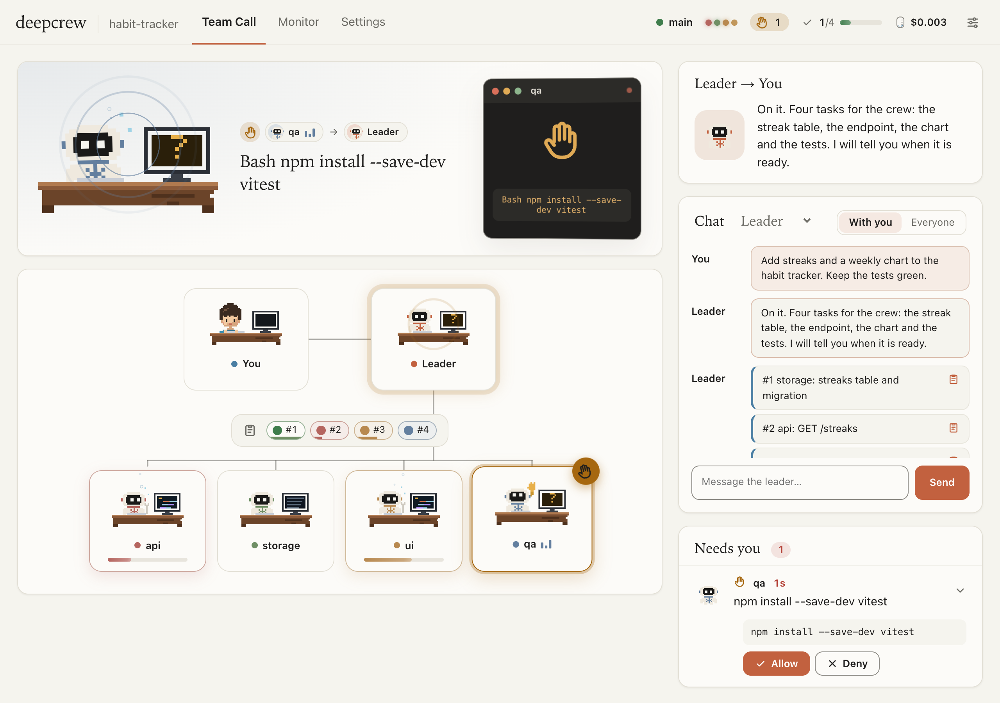</td>
<td width="50%" valign="top"><b>Monitor</b><br>你、leader、黑板和每个 agent 连成一张网，任务排成一张表，写着各自在等什么，下面是动态、决定和花费。<br><br>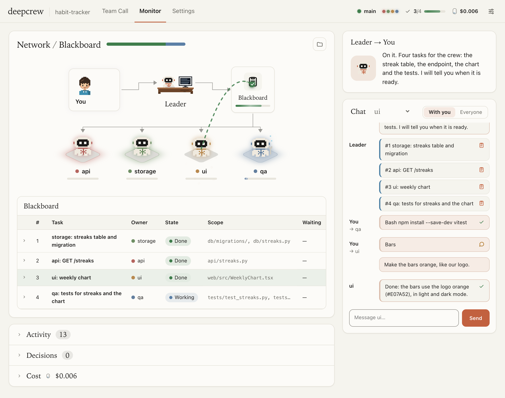</td>
</tr>
<tr>
<td width="50%" rowspan="4" valign="top"><b>Setup</b><br>key 只贴一次，选一个 preset 再点 <b>Done</b>。key 只存在这台电脑上，只发给你用的服务商，默认是 DeepSeek。<br><br>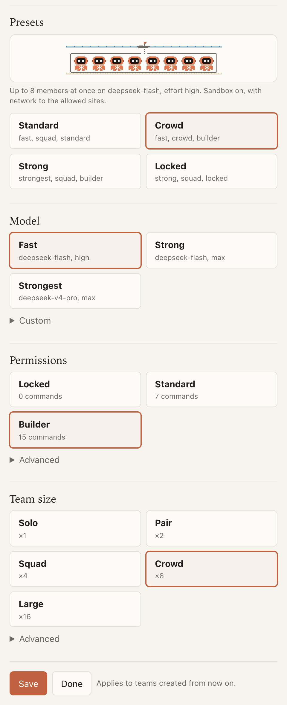</td>
<td width="50%" valign="top"><b>Approvals</b><br>常规命令先交给一个便宜的模型审，没问题就直接放行，剩下的在这里等你点 Allow 或 Deny，允许过的命令以后不再问。<br><br>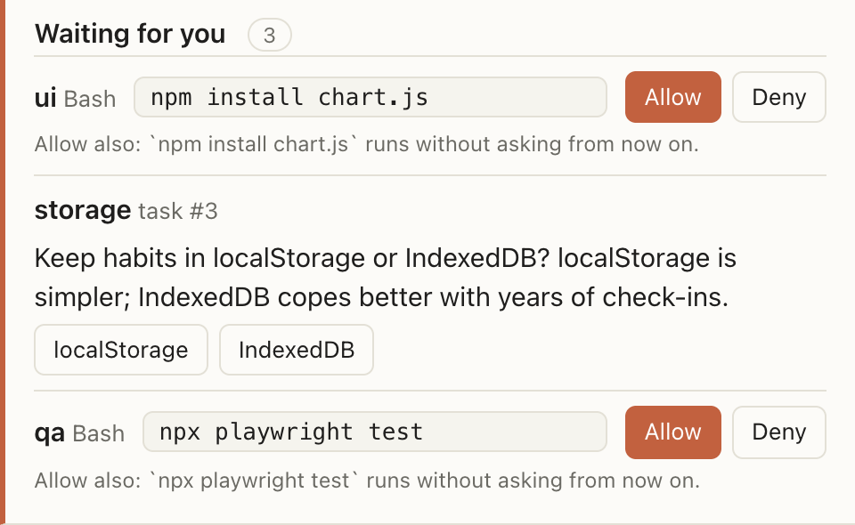</td>
</tr>
<tr><td valign="top"><b>Questions</b><br>agent 问 leader 的问题，你在这里也能直接回答。<br><br>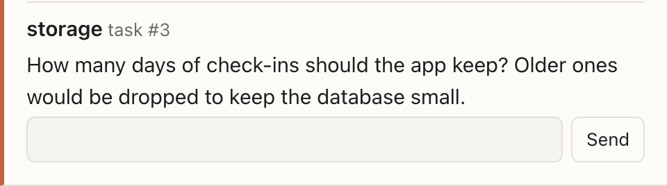</td></tr>
<tr><td valign="top"><b>The crew</b><br>谁在做什么、谁闲着都能看到，想让整个 swarm 停下，随时在这里点。<br><br>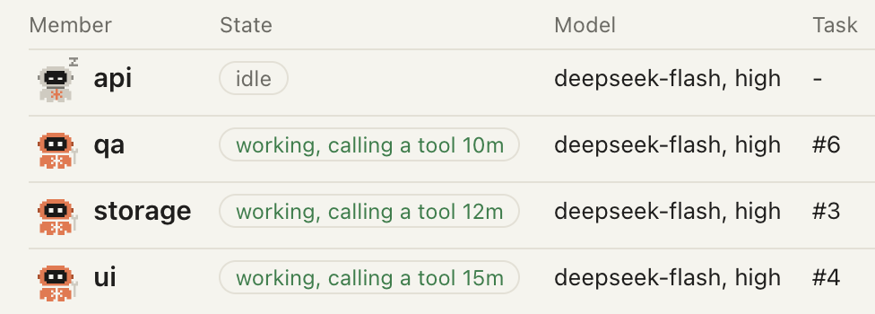</td></tr>
<tr><td valign="top"><b>Budget</b><br>用到 80% 时 leader 会提醒你，用完了 swarm 就自动暂停。<br><br></td></tr>
</table>

## Demo

下面这个 demo 只用了一句 prompt，左边是 swarm 干活的过程，用我还没放出来的回放功能录的，右边是做出来的东西。

> Generate a water pouring simulation with two containers, both 3D and 2D, with controls for the physics.

<table align="center">
<tr><td colspan="2" align="center"><b>3D demo</b></td></tr>
<tr>
<td align="center">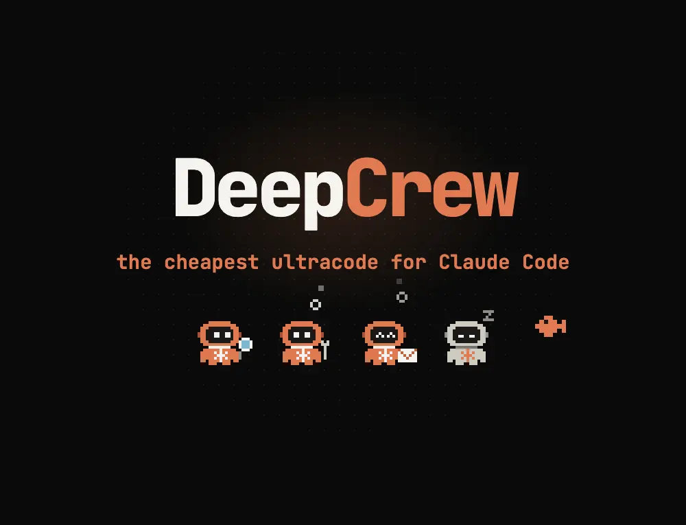</td>
<td align="center">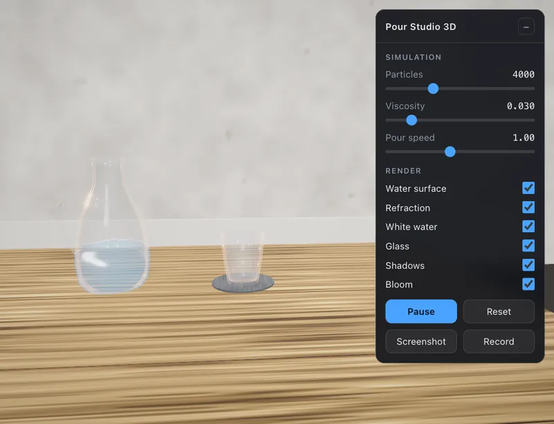</td>
</tr>
<tr><td colspan="2" align="center"><b>2D demo</b></td></tr>
<tr>
<td align="center">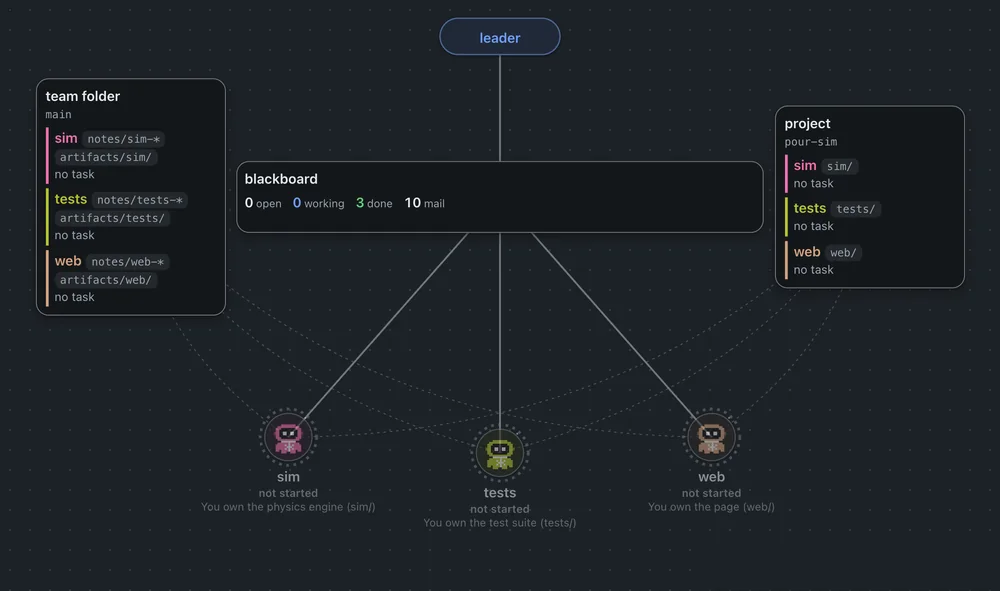</td>
<td align="center"></td>
</tr>
</table>

## Built for big jobs

一个 agent 做大活只能一步一步来，整个任务都得塞进同一个上下文里。DeepCrew 会像带团队的技术负责人那样先把活拆开，这也是它能接下大型、多模块任务的原因。

- leader 先把各部分之间的接口写成所有 agent 都会读的笔记，再按模块一件件发任务，写清每个任务能改哪些文件、要等哪些任务先做完。
- 每个 agent 只负责项目里的一块区域，改别处的文件会被直接拦下，所以最多 32 个 agent 可以在同一个文件夹里同时干活，互不冲突。
- 最难的核心部分交给服务商最强的模型，常规的部分用快模型。
- agent 之间会互相发消息报 bug，还会用截图工具检查自己做的页面，最后由 leader 做一轮只读的审查，看过 diff 之后由它自己提交。
- 没有哪个上下文需要装下整个任务，闲下来的 agent 会退出，有新活再接着原来的会话干，正在用的服务商没余额时备用的会接上，而你的套餐只花在 leader 身上，所以大活可以一直跑到做完。

## Quick start

**1. 下载。**

```bash
git clone https://github.com/KuiyiGao/deepcrew
cd deepcrew
```

**2. 最简单的用法是 Claude 桌面 App。** 在 App 里打开你的项目，把 `deepcrew` 文件夹拖进对话框，再说你想做什么，比如：

> 用这个文件夹装好 DeepCrew，然后用它做一个习惯打卡的网页应用，要有能用的页面和数据库。

Claude 会装好 DeepCrew、检查一遍环境，然后在聊天旁边打开团队页面，你把 DeepSeek 的 key 贴进去、选一个 preset、点 **Done**，agent 们就开始干活了。

<p align="center">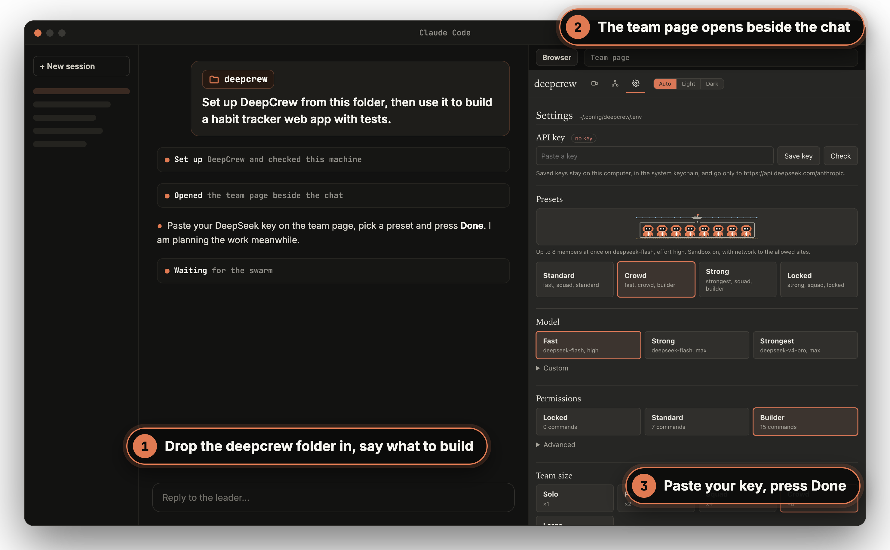</p>

习惯敲命令的话，在 `deepcrew` 文件夹里装好命令和带着 `/deepcrew` skill 与 mod 的 plugin，检查一下环境，然后在你的项目里打开 Claude Code，输入 `/deepcrew` 加上你的目标就行。

```bash
uv tool install .
claude plugin marketplace add ./
claude plugin install deepcrew@deepcrew
deepcrew check
```

第一次跑之前，建议先在 Claude Code 里输入 `/init`，让项目有一个所有 agent 都会读的 `CLAUDE.md`。装完以后如果终端里找不到 `deepcrew`，运行 `uv tool update-shell` 再开一个新终端就好。终端里的 Claude Code 和 Codex 怎么用，见 [Terminal, Codex and manual setup](#terminal-codex-and-manual-setup)。

### Updating

在 `deepcrew` 文件夹里拉下新版本，重装命令，更新 plugin，再开一个新的 Claude Code 会话。

```bash
git pull
uv tool install --reinstall .
claude plugin marketplace update deepcrew
claude plugin update deepcrew@deepcrew
```

## Claude Code mod

plugin 里带着 `/deepcrew` skill，Claude Code 2.1.287 及以上还会多一个 mod：agent 要批的命令和要问的问题会直接出现在输入框上方，按一下就处理了，和在团队页面上点完全一样。想看进度也不用再问 leader，所以不占你套餐里的额度。

- 最早的那个请求会停在输入框上方，带 **Allow**、**Always**、**Deny** 三个按钮，如果是提问就显示它的几个选项。
- 输入 `/crew` 会用一行字说清 swarm 现在的进度，你和 leader 都看得到，同时打开一个面板列出所有请求和每个 agent。`/crew rest` 让 swarm 停下，`/crew resume` 让它接着干。
- 状态栏里能看到几个 agent 在干活、做完了几个任务、一共花了多少钱。

装一次就行，在终端里的 Claude Code 输入：

```text
/plugin install deepcrew --marketplace KuiyiGao/deepcrew
```

用桌面 App 的话，先跑一下 `deepcrew check`，它会给出适用于 App 自带 Claude Code 的两条安装命令。mod 显示的是 Claude Code 当前打开的那个项目的团队，如果提示找不到 `deepcrew`，用 `/plugin configure deepcrew@deepcrew` 填上它的完整路径。

## How the swarm works

<p align="center">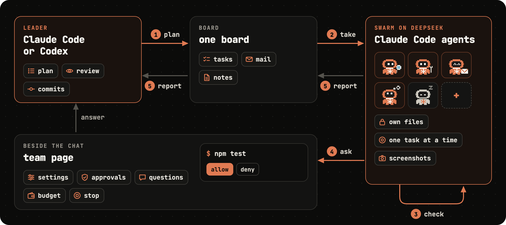</p>

<details>
<summary><b>Under the hood</b></summary>

- 每个 agent 就是一个由小 driver 启动的 `claude -p`，连的是 DeepSeek 或其他服务商兼容 Anthropic 的接口。key 只存在你这台电脑上，经 Claude Code 自己的 `apiKeyHelper` 交给它，只发给你选的服务商。
- 任务放在 Claude Code 自己的任务列表里，leader 往里发，整个 swarm 共用一块板。
- agent 想改不归它管的文件，会在工具调用之前被拦下，所有 shell 命令也都走同一个权限工具，它每次都会重新读一遍白名单。
- leader 按任务挑模型，难的部分交给最强的模型，普通的活用快模型，能省不少钱。
- 没活干的 agent 会自己退出，有新活了再接着原来的会话干。

</details>

## What it costs

<p align="center">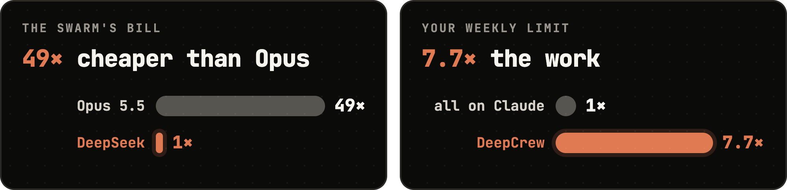</p>

同样多的 token，按 Opus 5.5 标价算，是按 DeepSeek 低谷价算的 49 倍，钱主要就省在这里：agent 整个跑在 DeepSeek 上，不经过 Claude，你的 Claude 额度只花在负责拆任务、派活和批命令的 leader 身上。`deepcrew prices` 能看到你用的服务商现在是什么价、什么时候变价。

7.7 倍是我实测出来的：所有 token 都按 Claude 标价算，leader 用掉的大约占 13%，1 除以 0.13 约等于 7.7，换个活儿这个数也会不一样。在团队页面上设个预算，花完了 swarm 就会自动暂停。

## Settings

在团队页面上选一个 preset，或者运行 `deepcrew config preset crowd`。

| preset | 模型 | 人数 | 权限 | 适合 |
|---|---|---|---|---|
| **standard** | fast | 4 | standard | 第一次试 |
| **crowd** | fast | 8 | builder | 任务多的项目，跑测试和构建不用问 |
| **strong** | strongest | 4 | builder | 难缠的 bug 和硬骨头，人越多越贵，按活儿定人数 |
| **locked** | strong | 4 | locked | 还不熟的仓库，不联网，除了读文件都先问你 |

也可以自己搭配，比如 `deepcrew config preset strongest crowd builder`。

- 模型有三档，用 DeepSeek 时 fast 是默认的 Flash 加 high 推理强度，strong 是 Flash 开到最高推理强度，strongest 是 V4 Pro 加最高推理强度，换成别的服务商时，三档对应它自己的模型。
- 人数可选 solo 1 个、pair 2 个、squad 4 个、crowd 8 个和 large 16 个，默认最多 8 个，想开到上限 32 个就运行 `deepcrew config set max_active 32`。
- 权限分三种：locked 开沙箱、不联网，只有读文件不用问。standard 是默认，不开沙箱，读文件随便读，常规命令由审命令的模型放行，其余的交给 leader 批，批过一次就不再问。builder 开沙箱，能连软件包仓库，跑测试和构建都不用问。
- 每个干活的 agent 刚启动时大约占 300 MB 内存，大家共用你的项目文件夹，不用容器也不用 worktree，闲下来的会自己退出，所以 8 GB 大约能跑 10 个，16 GB 大约 20 个，32 GB 能开到上限 32 个。
- agent 都会读你的 `CLAUDE.md`，只对这一次生效的要求，用 `deepcrew instructions "..."` 告诉它们。
- 换服务商用 `deepcrew config set provider zai`，智谱 GLM 和 MiniMax 也一样。用 `deepcrew config set fallback zai,minimax` 设好备用的，正在用的那家没余额或者一直过载时就会自动切过去。别的兼容 Anthropic 接口的服务商，在 `~/.config/deepcrew/providers.toml` 里加一条就能用。

<details>
<summary><b>Use your own setup</b></summary>

agent 用的是一套干净的 Claude Code 配置，你个人的设置不会带进 swarm，平时用的东西可以这样交给它们：

| 你有的 | 怎么交给 agent |
|---|---|
| `CLAUDE.md` | 什么都不用做，项目的 `CLAUDE.md`、`.claude/CLAUDE.md`、`.claude/rules/` 以及它们用 `@path` 引用的文件，agent 都会读 |
| MCP servers | `deepcrew mcp NAME`，从项目的 `.mcp.json` 或你的 Claude Code 设置里取 |
| skills | `deepcrew skill NAME`，从 `.claude/skills/` 或 `~/.claude/skills/` 里取 |
| 另一个仓库或文件夹 | `deepcrew link PATH`，允许 agent 修改就加 `--write` |
| 一个网站或 API | `deepcrew site DOMAIN` |
| 自己写的扩展 | 一个 Python 文件，用 `deepcrew config set extensions` 声明，装成模块的加 `--global` 就能在所有项目里用 |
| 登录状态、plugins 和别的东西 | 留在 leader 那边，agent 需要的时候，leader 用你自己的 Claude Code 去做 |

</details>

## Requirements

| | |
|---|---|
| Python | 3.11 或更新，配 `uv` 或 `pipx` |
| Claude Code | 2.1.133 或更新，测到了 2.1.295。agent 和 leader 用同一个 Claude Code，所以只装桌面 App 也够。用 Codex 当 leader 时，agent 用 PATH 上的 `claude`。mod 要 2.1.287 或更新 |
| 服务商 | 一个有余额的 DeepSeek API key，或者别家的。agent 读到的代码会发给这家服务商 |
| git | 项目里至少要有一次提交 |
| macOS | 直接能用 |
| Linux、WSL2 | 开沙箱的 preset 需要 `bubblewrap` 和 `socat` |
| Windows | 原生版 Claude Code、Git for Windows，以及 Python 3.11 或更新。开沙箱的 preset 要在 WSL2 里用 |

## Terminal, Codex and manual setup

**终端里的 Claude Code。** 在项目里启动 `claude`，贴上 `deepcrew` 文件夹的路径，像上面那样说需求，Claude 会把团队页面的链接打出来。

<p align="center">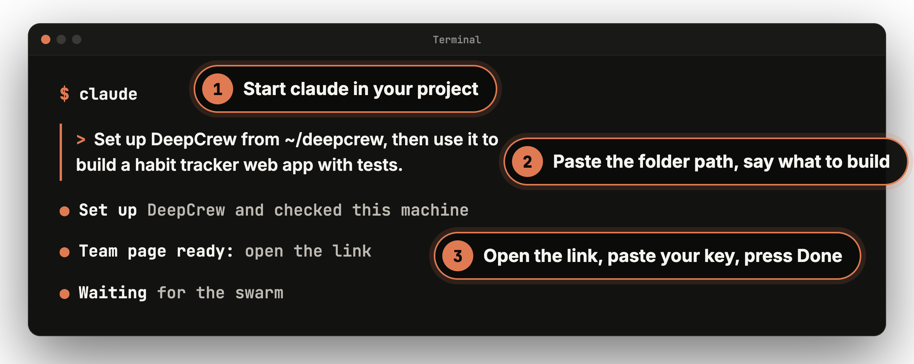</p>

**Codex。** 在 `deepcrew` 文件夹里装好命令和 skill，然后照样跟 Codex 说，或者输入 `$deepcrew` 加上你的目标。swarm 本身还是跑在 Claude Code 上，所以电脑上得装好 `claude`。

```bash
uv tool install .
mkdir -p ~/.agents/skills && cp -R mod/skills/deepcrew ~/.agents/skills/
```

**少点确认弹窗。** 想让 Claude Code 跑 `deepcrew` 时不用每次都问，还能在它自己的沙箱外运行，就把下面这段加进 `~/.claude/settings.json`：

```json
{
  "permissions": { "allow": ["Bash(deepcrew:*)"] },
  "sandbox": { "excludedCommands": ["deepcrew *"] }
}
```

## A call for prompts

swarm 怎么拆活全写在 prompt 里，而好的 prompt 来自真拿它干活的人。如果你有一句能让 swarm 在某类活儿上变聪明的 prompt，欢迎开个 PR，讲讲一次真实的使用：干的什么活、用的什么配置、团队页面上显示花了多少，以及改了之后有什么不同。

想改 deepcrew 自己发出去的那些 prompt，可以把自带的 `deepcrew/prompts/basic` 复制到 `~/.config/deepcrew/packs/mine`，改完用 `deepcrew config set pack mine` 换上。

## Coming next

回放、在真实项目上一轮轮调出来的 leader 和 agent prompt，还有更省钱的 economy mode，都还在我自己的版本里测着，稳定了就搬过来。

<div align="center">


### 如果 DeepCrew 帮你省下了额度，顺手点个 ⭐，能让更多人看到它

有问题、有想法、有好用的 prompt，都欢迎开 issue 或者发 PR。

[](https://github.com/KuiyiGao/deepcrew)

</div>

## License

[Apache 2.0](LICENSE)
